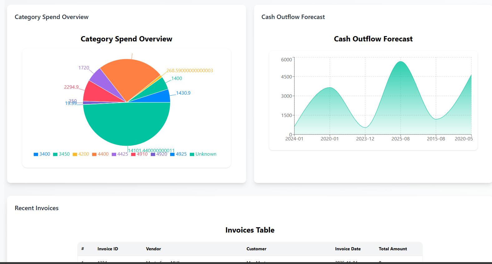
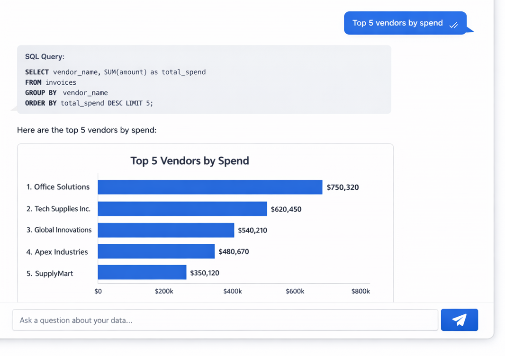

---
# 🚀 **AI-Powered Analytics Platform**

### *Interactive Dashboard + Natural Language “Chat With Data” (Vanna AI + Groq)*

**Docker-Based, Production-Grade Analytics System**

---

## 🎥 Project Walkthrough (Canva Video)

<p align="center">
  <a href="https://www.canva.com/design/DAG_55P61os/1lHLIk9UiLjyF5vuhqKfYQ/watch?utm_content=DAG_55P61os&utm_campaign=designshare&utm_medium=link2&utm_source=uniquelinks&utlId=h10ec611595">
    
  </a>
</p>

<p align="center"><i>Click the image to watch full platform walkthrough</i></p>

---

## 📌 **1. Project Overview**

This is a **full-stack, enterprise-style analytics platform** that enables users to:

* 📊 Explore financial data via **interactive dashboards**
* 💬 Ask **natural language questions** and get instant insights
* 🧠 Convert **NL → SQL → Charts** using AI
* 🧱 Run everything locally using **Docker**
* ⚡ Leverage **Groq LLM + Vanna AI** for fast analytics

Designed to mimic **real-world SaaS analytics products**.

---

## 🌟 **2. Key Capabilities**

### 📊 Interactive Analytics Dashboard

* Total Spend (YTD)
* Total Invoices Processed
* Average Invoice Value
* Invoice Trend Analysis
* Vendor Spend (Top 10)
* Category-wise Spend
* Cash Outflow Forecast

---

### 🤖 AI-Powered “Chat With Data”

Ask business questions like:

* *“Top 5 vendors by spend”*
* *“What is total spend in last 90 days?”*
* *“Show overdue invoices”*

✔ AI generates SQL
✔ SQL runs on PostgreSQL
✔ UI displays **query + table + chart**

---

## 🖼️ Chat With Data – Example Output

### 🧠 AI Query Result: **Top 5 Vendors by Spend**

<p align="center">
  
</p>

<p align="center"><i>AI-generated SQL + analytics visualization</i></p>

---

## 🧱 **3. Architecture Overview**

```
User (Dashboard / Chat UI)
        ↓
Next.js Frontend
        ↓
Node.js Backend (APIs)
        ↓
Vanna AI Service (FastAPI)
        ↓
Groq LLM → SQL Generation
        ↓
PostgreSQL Database
```

✔ Clean separation
✔ Microservice-friendly
✔ Production-ready design

---

## 🗂️ **4. Monorepo Structure**

```
📂 apps
 ├── 🌐 web        → Next.js frontend
 ├── 🔌 api        → Backend APIs
 └── 🤖 vanna      → AI / NLP service

📂 data
 └── 📄 analytics_data.json

📂 docker
 ├── 🐳 docker-compose.yml
 └── 🧱 Dockerfiles

📂 prisma | drizzle
 └── 🧬 Database schema

📂 assets
 ├── 🖼️ analytics-dashboard.png
 └── 📊 chat-top-5-vendors.png

```

---

## 🗄️ **5. Database Design**

**Core Tables**

* vendors
* invoices
* line_items
* payments
* categories

**Relationships**

* Vendor → Invoices (1:N)
* Invoice → Line Items (1:N)
* Invoice → Payments (1:N)
* Category → Invoices (N:1)

---

## 🔌 **6. API Endpoints**

| Endpoint          | Method | Purpose            |
| ----------------- | ------ | ------------------ |
| `/stats`          | GET    | Dashboard KPIs     |
| `/invoice-trends` | GET    | Monthly trends     |
| `/vendors/top10`  | GET    | Vendor ranking     |
| `/category-spend` | GET    | Category analytics |
| `/cash-outflow`   | GET    | Forecast           |
| `/chat-with-data` | POST   | NL → SQL           |

---

## ⚙️ **7. Environment Configuration**

### Backend

```
DATABASE_URL=postgresql://user:pass@db:5432/analytics
VANNA_API_BASE_URL=http://vanna:8000
```

### Vanna AI

```
DATABASE_URL=postgresql+psycopg://user:pass@db:5432/analytics
GROQ_API_KEY=your_key_here
PORT=8000
```

---

## 🐳 **8. Docker Setup**

```bash
docker compose up --build
```

Services:

* Frontend → [http://localhost:3000](http://localhost:3000)
* Backend → [http://localhost:5000](http://localhost:5000)
* Vanna AI → [http://localhost:8000](http://localhost:8000)
* PostgreSQL → 5432

---

## 💬 **9. Chat-With-Data Execution Flow**

1. User asks question
2. Frontend → Backend
3. Backend → Vanna AI
4. Vanna → Groq → SQL
5. SQL runs on DB
6. Results returned
7. UI renders table + chart

---

## 🎁 **10. Why This Project Stands Out**

* ✅ AI-driven analytics (NL → SQL)
* ✅ Dockerized full-stack system
* ✅ Clean SaaS-style UI
* ✅ Real database + real queries
* ✅ Production-oriented architecture

---

## 🙌 **Acknowledgements**

* Vanna AI
* Groq LLM
* Next.js
* Prisma / Drizzle
* Tailwind CSS

---

